# serpwise

[](https://www.npmjs.com/package/serpwise)
[](https://github.com/sumitroajiprabowo/serpwise/actions/workflows/ci.yml)
[](LICENSE)
[](https://agentskills.io)

SEO for AI coding agents, based on Google's own documentation.

serpwise is an [Agent Skill](https://agentskills.io) for Claude Code, Codex, GitHub Copilot, Antigravity and other agents that support the format. It gives your agent the guidance in [Google Search Central](https://developers.google.com/search/docs) and a set of commands for common SEO work. With it, your agent can:

- audit a page;
- fix indexing problems in your codebase;
- write structured data;
- plan a site migration;
- work out why search traffic dropped.

```bash
npx serpwise
```



## Why it exists

Ask an AI agent about SEO and you get the internet's average opinion, including advice Google doesn't support, such as ideal title lengths, description lengths and word-count targets. serpwise points the agent at the source instead. Every finding is rated by severity (Critical, High, Medium, Low) and names the Google rule it comes from, so you know what to fix first and why.

The agent also declines spam tactics such as buying links or mass-producing city pages, explains which Google policy they break, and suggests what to do instead.

## With and without serpwise

We gave Claude Code the same broken landing page twice, once with serpwise and once with skills turned off, and asked for an SEO audit. Both runs found the obvious blockers, such as the `noindex` tag and the `` that ends `<head>` early. A strong model catches those on its own. The difference was in the rest of the advice:

| | Without serpwise | With serpwise |
|---|---|---|
| Title | "Aim for 50–60 characters" | Describe the page and include the brand. No character target, because Google sets none |
| Meta description | "Write 140–160 characters" | Write something specific to the page, with concrete facts |
| `<html lang>` | Listed as an SEO fix | Added for accessibility, with a note that Google detects language from the visible content |
| Severity | Numbered list | Critical, High, Medium or Low for every finding |
| Sources | A Google rule mentioned for 1 of 17 items | A Google rule for 18 of 19 findings |

Both reports are in [`examples/`](examples/), unedited.

## How it differs from other SEO skills

Every rule comes from Google Search Central. Advice Google doesn't support, such as meta keywords, fixed title lengths or an llms.txt file for AI Overviews, sits in a myths list, so the agent corrects it instead of repeating it.

There are no accounts, API keys or paid data providers. The auditor needs nothing beyond the Python standard library, and the skill itself is plain Markdown that works in any agent that reads [Agent Skills](https://agentskills.io).

It covers Google Search and nothing else. If you need keyword research, rank tracking or backlink data, use a tool built for that.

## Commands

```
/serpwise                                  list the commands
/serpwise audit https://example.com/page   audit a page
/serpwise fix                              find and fix SEO issues in this repo
/serpwise schema product.html              write or validate JSON-LD
/serpwise meta index.html                  write the title and meta description
/serpwise robots https://example.com       review robots.txt
/serpwise sitemap https://example.com/sitemap.xml
/serpwise hreflang                         set up a multilingual site
/serpwise migrate                          plan a domain, HTTPS or URL change
/serpwise drop                             diagnose a drop in Google traffic
/serpwise content post.md                  review content quality
```

In Codex, use `$serpwise` instead of `/serpwise`. You can also just describe the problem ("why isn't my site on Google?") and the agent will pick up the skill.

## Installation

```bash
npx serpwise                  # install for every supported agent on this machine
npx serpwise --project        # install into the current project only
npx serpwise@latest update    # npx may cache an old version, so ask for @latest
npx serpwise uninstall
```

The installer copies the skill to these places:

- `~/.claude/skills/serpwise` for Claude Code;
- `~/.agents/skills/serpwise` for Codex, Copilot and similar agents;
- `~/.gemini/config/skills/serpwise` for Antigravity.

It skips Claude Code or Antigravity if they aren't installed. Use `--agents claude,antigravity` to install for them anyway.

With `--project`, it writes `.claude/skills` and `.agents/skills` inside your project instead (Antigravity reads `.agents/skills` there), so you can commit them and share the skill with your team. Restart your agent after installing.

Other options:

| Method | Command |
|---|---|
| skills.sh | `npx skills add sumitroajiprabowo/serpwise` |
| Claude Code plugin | `/plugin marketplace add sumitroajiprabowo/serpwise`, then `/plugin install serpwise@serpwise` |
| No Node.js | `git clone https://github.com/sumitroajiprabowo/serpwise && ./serpwise/install.sh` |
| Claude.ai | Zip `skills/serpwise` and upload it under Settings → Capabilities → Skills |

## Page auditor

The skill includes a small page auditor with no dependencies beyond Python 3.8. Your agent runs it during an audit, and you can also run it yourself. It covers the parts of an audit that a script can check reliably:

- status codes and redirects;
- robots.txt rules as Googlebot reads them;
- `noindex` and canonical tags;
- titles and meta descriptions;
- hreflang;
- image alt text;
- crawlable links;
- JSON-LD syntax;
- invalid elements in `<head>`;
- Googlebot's 2 MB HTML limit.

```bash
npx serpwise audit https://example.com
npx serpwise audit index.html --base-url https://example.com/ --offline
npx serpwise audit https://example.com --fail-on high   # exit 1 if anything is High or Critical, for CI
```


It reads the HTML as served and doesn't run JavaScript. For single-page apps, check the rendered result with URL Inspection in Search Console.

## Tested agents

We gave each agent the same task: audit a landing page with eight planted problems.

| Agent | Version | Loaded the skill without being told | Problems found |
|---|---|---|---|
| Claude Code | 2.1 | Yes | 8 of 8 |
| Codex CLI | 0.169 | Invoked with `$serpwise` | 8 of 8 |
| Antigravity CLI | 1.5 | Yes | 8 of 8 |
| GitHub Copilot CLI | 1.0 | Yes | 7 of 8 |

## Repository layout

- `skills/serpwise/SKILL.md`: the instructions the agent loads first.
- `skills/serpwise/commands/`: one playbook per command.
- `skills/serpwise/references/`: condensed Google Search Central guidance that the agent reads when a task needs it.
- `skills/serpwise/scripts/audit_page.py`: the page auditor.
- `bin/serpwise.mjs`: the `npx serpwise` installer.

## Contributing

Google changes its documentation often, so corrections are the most useful contribution. See [CONTRIBUTING.md](CONTRIBUTING.md) for how to send one, and [CHANGELOG.md](CHANGELOG.md) for release notes.

## License

MIT. The reference material paraphrases Google Search Central documentation, which Google publishes under [CC BY 4.0](https://creativecommons.org/licenses/by/4.0/). serpwise is not affiliated with or endorsed by Google.
